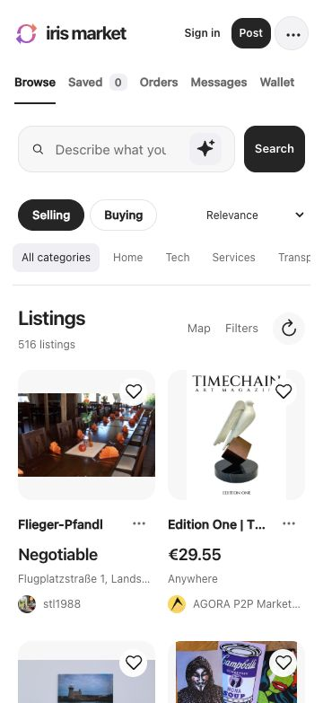

# Iris Market

A general marketplace for things, skills and opportunities. Native iOS, Android and macOS apps share a Rust core for selling, buying, saved listings and private enquiries. The browser app supports visual browsing, Nostr sign-in, listing publication, private chat, orders, parcel tracking and share links. Listings, profiles, posting, saved items, messages, orders, wallet and settings have their own routes; short confirmations remain dialogs. AI assistants can use the same native operations through the CLI or MCP.

**Internet first.** Ordinary Nostr servers provide discovery and delivery in this prototype. Nearby Wi-Fi/Bluetooth and FIPS mesh exchange are planned backup carriers. They are not implemented or advertised as working in v0. Intermediary matching ("asking for a friend") is also deferred.

## Current prototype

- SwiftUI iOS and Jetpack Compose Android interfaces, plus a responsive browser app. Appearance can follow the system or use a light/dark override. Preview is explicit and separate from live inventory.
- Signed NIP-99 listings, Selling/Buying search and saved listings. Native/CLI clients add withdrawal, local persistence and durable listing publication queues. Browser posting retains the signed retry attempt while its form remains open; it is not a durable draft archive. A server acknowledgement confirms publication; a queued event is not reported as delivered.
- Private enquiries and invitation links use the published Iris Chat protocol engines. Protocol state, message history and the private outbox are encrypted at rest. Native account and provider credentials use Keychain / Android Keystore. Newly generated native profiles atomically persist their first signed device roster and public outbox before networking starts. Existing/imported profiles are not silently enrolled or granted device permissions; pre-alpha legacy identities without a signed roster still need an explicit approved enrollment path for strict Iris Chat interoperability. Browser chat uses `nostr-double-ratchet` 0.0.183 with separate approved device keys, new-message fanout and revocation.
- Native AI search defaults to an available on-device model for an untouched profile, while remembering an explicit Off or provider choice. Settings save automatically, include provider/model presets and a connection test, and keep remote credentials in secure storage. Only submitted searches and public listing text are evaluated; private conversations are never sent.
- Browser browsing, local saved listings and shareable listing details work without an account or signing key. The default page loads real Nostr listings; fixtures are restricted to explicit Preview. Tags and the selected social network can narrow discovery without a public-key entry field. Enter a name to create a profile, or choose Existing profile for a browser extension, NIP-46 remote signer, device linking or an imported private key. A linked chat device connects the same account’s posting signer separately when needed.
- Public author profiles, following and observed follower lists, known connections and relationship checkmarks. The visitor network starts from Sirius Business, including when no profile is signed in. On the web, new profiles and profiles without observed follows also use this starting network; a verified nonempty personal follow list switches to the personal graph in the background.
- Relevance combines search matches, optional AI scores, social connections, freshness, saved categories and nearby listings when location is known. Social and Newest are separate sort choices. The unfiltered Selling feed starts with photos; Filters can include listings without them. Saved items remain in Browse.
- Listing maps use the same pinned Hashtree basemap as Iris Maps, with a bounded public-data cache and markers from signed geohash tags.
- The browser creator offers optional delivery destinations and a fixed delivery cost, plus Delivery / Passenger ride / Both for transport listings. Price can stay blank for negotiation; payment conditions remain in the description. Delivery options use the draft extension described below. Native delivery-option creation is pending.
- Listing expiry is optional, with relative presets in the browser. The signed event retains an absolute deadline, and expired listings stay hidden. Native expiry controls are undergoing platform validation for the next build.
- One search field for text or optional AI matching. Browser-local AI can prepare its local model automatically, with inline progress, cancellation and a Show all override. It is experimental; marketplace accuracy is not established.
- Named CLI commands, a local JSON action interface and MCP stdio tools for search, publication, saved listings, contact, messages and private orders.

This is a development prototype. The browser includes an optional Cashu wallet; shipping guarantees, escrow, automatic earlier-history transfer, group conversations and saved matching watches are not implemented. Native Cashu adapters and secure seed storage are present behind the disabled `cashu-wallet` feature; native wallet compilation and UI acceptance are pending. Native local AI supports Apple’s available system model and an optional Android model download; Android inference on actual model weights remains unverified. The CLI source package is published on crates.io. Signed Android and notarized macOS downloads are available in [v0.1.1-alpha.1](https://github.com/irislib/iris-market/releases/tag/v0.1.1-alpha.1). iOS 0.1.1 (4) is available to the existing internal TestFlight group. The alpha includes the compact search action and photo-only Selling home feed; searches, Saved and profiles can include listings without photos.

Web: [market.iris.to](https://market.iris.to) · [App builds and CLI](https://getmarket.iris.to). Source: [GitHub](https://github.com/irislib/iris-market). Hashtree source: [iris-market](https://git.iris.to/#/npub1xdhnr9mrv47kkrn95k6cwecearydeh8e895990n3acntwvmgk2dsdeeycm/iris-market).

Windows currently uses the [web app](https://market.iris.to/) or the [x64 CLI download](https://github.com/irislib/iris-market/releases/download/v0.1.1-alpha.1/iris-market-v0.1.1-alpha.1-cli-x86_64-pc-windows-msvc.zip). A native Windows GUI is not implemented; Windows PWA installation and runtime have not been manually verified.

The browser feed below uses real public listings. Native alpha builds share the same visual direction and use platform system fonts.



## Repository

- `crates/market-core`: validation, local SQLite data, relay transport, ratchet adapter, public profiles, ranking and AI curation.
- `crates/market-app`: UniFFI entry point shared by native apps.
- `crates/market-cli`: local agent commands and MCP.
- `ios`, `android`: native presentation, secure credentials and lifecycle.
- `web`: browser client, Nostr account/signing adapters, private messaging, public profiles, ranking, currency display, Hashtree maps, the native map shell and optional local AI worker.
- `site`: landing page with signed native downloads, source instructions and CLI installation.
- `scripts`: repeatable builds and focused UI checks.
- `crates/market-app/CONTRACT.md`: native command/state contract.

The product remains general. Specialised task details can extend a common listing rather than requiring separate category-specific apps. Public discovery and private conversations remain separate; future private matching will need explicit disclosure and delegation permissions.

## Build

Rust is pinned by `rust-toolchain.toml`; dependency checksums and versions are in `Cargo.lock`. Builds use `--locked`. Native generated bindings are regenerated from the same Rust library used by each platform.

```sh
./scripts/verify-fast
cargo build --locked -p iris-market
```

### Browser and download page

Requires Node.js 22 or newer; the tested version is pinned in `.nvmrc` (26.12.0). `web/package-lock.json` pins the browser, build and deployment dependencies. The browser and download page build together:

```sh
cd web
npm ci
npm test
npm run build
npm run dev
```

The development server stays running at `http://127.0.0.1:4173`; rebuild after source changes and reload to see them. It disables its own service worker so development reloads cannot get stuck on an older offline bundle. Set `MARKET_PWA_TEST=1` on a separate port to test the production offline lifecycle. On the local browser, add `?preview=1` for sample listings without relay connections. To serve the download page instead, run `MARKET_SITE=downloads PORT=4174 npm run dev`. The build writes `web/dist` and `site/dist`; it also packages the native map shell, MapLibre workers, local AI worker, compressed WASM runtime and third-party notices. It includes no model weights or map archive. All npm inputs, including Hashtree and social-graph release tarballs, have integrity hashes in the lockfile. The build verifies the exact unpacked ONNX runtime hash before compression.

The checked-in Cloudflare configurations target the domains above. With an authorised hosting account, deploy the built assets from `web` with the lockfile-installed Wrangler binary:

```sh
./node_modules/.bin/wrangler deploy --config wrangler.jsonc
./node_modules/.bin/wrangler deploy --config ../site/wrangler.jsonc
```

A successful build does not establish deployment. Verify both HTTPS destinations after deployment. No credentials or account identifiers belong in source.

Hashtree can publish the same tested static directories as the named trees `market` and `getmarket`. From the repository root, set `HTREE_BIN` to an installed `htree` executable. The release script checks its pinned SHA-256; the current pin is for the Darwin arm64, source-built Haps 0.1.22 helper (`htree` 0.2.150), with provenance recorded in the script. It does not install tools or build assets. Commit the accepted source and inspect the final build before publishing:

```sh
node --test scripts/publish-hashtree.test.mjs
node scripts/publish-hashtree.mjs inspect web
node scripts/publish-hashtree.mjs inspect downloads
node scripts/publish-hashtree.mjs publish web --commit FULL_COMMIT --assets WEB_MANIFEST_SHA256
node scripts/publish-hashtree.mjs verify web --ref PUBLISHED_NHASH --assets WEB_MANIFEST_SHA256
node scripts/publish-hashtree.mjs publish downloads --commit FULL_COMMIT --assets DOWNLOAD_MANIFEST_SHA256
node scripts/publish-hashtree.mjs verify downloads --ref PUBLISHED_NHASH --assets DOWNLOAD_MANIFEST_SHA256
```

Use the full commit and asset digests returned by `inspect`, and each immutable hash returned by `publish`. Publication requires a clean working tree and writes through the publisher's configured Hashtree identity. Verification downloads every file with a fresh configuration and cache, without a signing identity or local daemon, then compares the exact asset manifest. Run the two verification steps sequentially; each removes its own temporary download and cache. Source publication is separate: push the accepted full commit to `htree://self/iris-market` as `refs/heads/main`, then verify that commit and its history through a fresh public-owner fetch. These commands publish static web/download releases. The separate native alpha scripts below build, verify and publish signed native and CLI artifacts. Treat a channel as published only after its public read succeeds.

The browser validates signed NIP-99 events before displaying them and retains sold/expired winning revisions to reject older replayed copies. A `?listing=<author:identifier>` link adds a narrow lookup for that listing beyond recent inventory. Default public relays match Iris Client: temp.iris.to, vault.iris.to, relay.damus.io, relay.snort.social, relay.primal.net and nos.lol. Explicit relay preferences remain unchanged. Saved IDs, relay preferences and appearance are local to the browser. The installable PWA stores a hash-verified app shell (bounded to 24 MiB) and up to 1,000 signed public listing winners (64 KiB each) in separate storage. Previously loaded listings, saved items and routed item pages can be reopened offline. Remote photos, map regions and model downloads are not guaranteed offline. Private chats, keys and wallet data never enter the public shell/listing cache. Browser quota refusal or eviction can make offline storage unavailable; failed inventory writes disable stale stored inventory. Service-worker updates wait for existing tabs to close and never reload an active draft or order. The Open app link opens an installed native client; it does not yet hand off the selected listing or implement universal links.

Browser text and AI search both commit on Enter or Search. Clearing the field resets the search immediately, including a running AI pass. Browsing shows 24 cards, adds two batches automatically as the user scrolls, then uses an explicit Load more button. Each added window displays matches as they arrive; neither a complete batch nor all source replies are needed before showing a verified match. The AI status reports matches without exposing its internal batch target. The top-right menu contains Courier, Settings, Get app and Light/Dark/System controls. Profile management lives at `/settings/profile`; the avatar opens the public `/npub…` profile.

The browser courier workspace has Find work, My jobs and My service views, with Parcel, Passenger and Both filters. Public gigs and service announcements use ordinary kind 30402 Selling/Buying listings with explicit transport topics. Area text filters apply on submit; unrelated transport listings such as buying a car are excluded. Announcing a service opens the normal editor and preview and preserves unfinished drafts. Assigned jobs and optional live location remain private. Completed-order participants can open each other's general public reviews; these are not labelled verified-purchase reviews and publish no order identifier or private route.

Posting uses Selling/Buying tabs and a preview before publication. The preview never uploads selected files or requests a signature. An optional local expiry date/time writes a Nostr `expiration` timestamp; expired items disappear from lists and open details without waiting for a relay. Item pages show the original `published_at` date when valid, otherwise the event timestamp. Edits preserve that original date.

Ships to is an optional country filter under Filters. It reads verified explicit `shipping_option` references using the [draft marketplace extension linked by NIP-99](https://github.com/GammaMarkets/market-spec/blob/main/spec.md): direct kind 30406 or one collection hop through kind 30405. Pickup country tags do not imply delivery; missing details do not count as matches. Item location remains a separate filter, never an inferred shipping origin. The icon beside Ships to requests a one-time browser location and selects the country locally using bundled public-domain Natural Earth boundaries; uncertain border/coastal results leave the manual choice unchanged. The icon beside Item location selects a 50 km nearby filter. Only a position rounded to roughly 1 km remains in memory; it is not stored or sent to a geocoder. Discovery shares a coarse search area with the selected listing relays when that filter is applied. This is country coverage from observed public records, not a shipping quote or validation of weight, dimensions, regional eligibility or availability. Reads are bounded and incomplete source coverage stays partial.

### Browser accounts and messages

Browser sign-in creates or restores a separate stable chat device key authorized by the account’s signed AppKeys roster. Browser extensions retain the account private key outside Market. NIP-46 chat sign-in requests only device-authorization signing; a linked device can later connect the same account’s extension or remote signer for profile, follow-list and listing signatures. A mismatched account is rejected. The public posting connection requests kinds 0, 3, 7368, 30402 and 24242 and expires after fifteen minutes. Kind 24242 is restricted to validated, short-lived upload authorizations and is never published to Nostr relays. Account creation and private-key import keep their account key in the encrypted browser vault. Backups are exposed only by the explicit account action.

The vault encrypts its full snapshot with AES-GCM in IndexedDB. The default sign-in interface uses a per-origin, nonextractable WebCrypto key stored by the browser, so it does not require a new password. The storage adapter also supports an optional passphrase mode using PBKDF2-SHA256; this is not currently a separate setup choice in the sign-in interface. Browser-managed encryption protects stored data, not an unlocked page from malicious scripts. Lock closes messaging connections and drops the in-memory keys and messages. The vault currently limits its serialized private data to 8 MiB and each conversation to 1,000 messages; it rejects stale writes from another browser tab instead of overwriting newer ratchet state.

New messages fan out to authorized recipient devices and the sender’s other devices. Removing a device prevents new sends and retrying queued ciphertext to that device once the newer signed roster is observed. This does not transfer earlier message history to a newly linked device. Failed registration retains the pending device key before publication, so a retry can finish the same authorization. Private outbox entries retain the exact signed ciphertext for retry; `sent` means server acknowledgement, not a read receipt. Relay setting changes reconnect the same account and device. Offline restoration keeps sending paused until signed authorization can be checked against available server responses.

Private invitation URLs carry their capability in the fragment. The browser captures an `/invite#…` link in memory, immediately removes the fragment from the visible URL, and offers an explicit action to open it after sign-in. Invitation capabilities are never added to public listings or profile queries.

Feed filters support up to eight Nostr tags and the direct follows of the selected public social graph. Visitors can browse Everyone or the named default network; signed-in users can choose People I follow. The filter uses the existing graph context without a separate public-key entry or blocking follow lookup. Public follow and tag queries are visible to the chosen relays.

### iOS simulator

Requires macOS, Xcode with an arm64 iOS simulator SDK, XcodeGen and the `aarch64-apple-ios-sim` Rust target. The app targets iOS 16+. The Rust C dependencies receive the matching minimum deployment version.

iOS uses the SQLite library supplied by the selected Apple SDK and operating system; the build wrappers explicitly select it and do not search host package-manager libraries. Other targets retain the lockfile-pinned bundled SQLite. Private message encryption remains in the existing application storage layer, before database writes.

```sh
./scripts/ios-core
./scripts/ios-build
```

Simulator signing is ad hoc and uses simulator-only entitlements so Keychain works. It requires no personal signing team. Signed physical-device alpha builds and internal TestFlight submission use the separate release tooling below. Simulator build success alone does not establish distribution.

UI tests require an explicitly allocated simulator. They never select or reset an arbitrary device:

```sh
MARKET_IOS_SIMULATOR_ID=<allocated-simulator> ./scripts/ios-ui-check
```

### Android

Requires JDK 17, Android SDK 36, NDK 28.2.13676358 and the `aarch64-linux-android` Rust target. The initial APK is arm64 and targets Android API 29+. Set `ANDROID_HOME` or `ANDROID_SDK_ROOT` to the installed SDK.

```sh
./scripts/android-build
```

The Gradle wrapper distribution and wrapper binary are pinned and checked. The committed lockfile and dependency-verification metadata cover the resolved build inputs; routine builds use strict verification. `--bootstrap-locks` is for deliberately reviewing dependency changes, not normal builds.

UI tests require an explicitly allocated emulator: `./scripts/android-ui-check emulator-<allocated-port>`. This runner rejects physical devices and never selects an arbitrary emulator.

### App preview

The iOS simulator accepts `--demo`; Android accepts the boolean intent extra `demo=true`. Native Preview uses sample inventory, separate storage and no network calls. The browser uses `?preview=1`, makes no relay connections and disables public-follow lookups in Preview. Explicitly loading a browser AI model or opening the browser map can still download public assets while viewing sample listings. Native Preview disables network-backed maps and live profile queries. Sample posts can never be published. Live mode starts with verified relay inventory.

## Profiles and discovery

Hearts save listings locally without removing or reordering them in Browse. Incoming private messages and order updates add unread dots; opening the affected conversation or order marks it read. Own updates and ephemeral courier positions do not create unread notifications. Read markers store bounded per-profile hashes, not message text or payment tokens.

Open an author from a listing to view their listings, public kind-0 metadata, following, observed followers and people in the selected network who follow that author. Browser profiles open on that author’s listings, with connections in secondary tabs. Canonical profile links use `/npub…`; listings use `/npub…/<identifier>` or a NIP-19 `naddr`. Editing an addressable listing preserves its link. Query-based links remain supported for static directory mounts. Profile and follow-list events are signature-checked before they reach `nostr-social-graph`; winner selection follows creation time and the lowest event ID on a tie. Native and web relationship presentation reuses the Iris Chat rules with its MIT attribution preserved.

Native profiles fetch signed author listings independently of Browse and show cached listings immediately. Load more expands the author query in batches of 48, up to 240 listings. The public subscription closes when leaving the profile or after 30 seconds; available results reflect observed relay records, not exhaustive history.

Sirius Business is the default network root in both clients, using the same public key as Iris Client: `336f319763657d6b0e65a5b5876719e8c8dcdcf9396852be71ee26b73368b29b`. A visitor does not need to sign in. The browser also allows an explicit public-profile override. Unknown/empty personal follow lists keep the default root; a previously observed nonempty graph remains selected through temporary lookup failures. Labels name the selected root, so “known” does not imply that a visitor personally knows those people. Direct follows receive the following checkmark; a second-degree connection receives a friend checkmark, or the stronger connection style when more than ten people followed by the root also follow that author. These marks describe observed graph relationships, not verified identity, reliable transactions or seller endorsement.

For the default Sirius Business context, the browser also loads a SHA-256-pinned serialized snapshot from `nostr-social-graph@2.0.4` (1,182,110 bytes). It provides initial ranking and helps select bounded second-hop lookups. Its edges are older unsigned data: they never produce trust badges or known-follower claims. Those indicators require live signature-checked lists. Verified live records take precedence over snapshot edges, including observed unfollows and unsupported newer records.

The graph is deliberately partial: each signed list accepts up to 4,096 public keys, discovery fetches at most 32 second-hop lists, profile lookup considers at most 64 inbound candidates, and lists display at most 256 people. Inbound candidates are refreshed without the follower filter before they are shown, so a stale follow record does not override an observed later unfollow. Counts and distances describe the loaded public records, not the entire Nostr network. Missing records remain unknown. Profile reads never publish follow/unfollow events, and no private contact list is uploaded.

Relevance ordering is deterministic over the available inventory. Text or current-query AI relevance carries the strongest weight; public graph distance and known followers, a modest freshness boost (14-day half-life), saved categories and optional nearby location refine it. Unknown location is neutral and coarse geohash cells receive less proximity weight. A bounded seller-diversity penalty prevents one catalogue dominating without burying strong matches. Social explicitly emphasizes graph connections; Newest is strict chronology. Sorting uses per-author queues and a heap rather than a quadratic repeated scan. A fixed seven-case synthetic ranking check improved mean nDCG@3 from 0.671 to 0.986; injected AI scores test ranking behavior, not model accuracy. On the development host, 5,000-item sorts took about 7–8 ms versus 94–119 ms previously. No paid boosts or click tracking are used.

## Browsing and media

Selling is selected initially; Buying switches to wanted listings. The grid starts with 24 cards and appends 24 at a time near the bottom. After two automatic batches, further loading requires Load more; clicking it never restarts automatic loading. This keeps the footer reachable and preserves the current browsing position. Already browsed cards stay in place as live results change. Filters or a new sort reset the window. Older relay history is requested separately with bounded requests, signature checks, inclusive timestamp boundaries and an explicit retry on failure. The page retains at most 1,000 listing coordinates, including tombstones; it does not claim to contain the entire network.

Remote listing photos and avatars use the Iris image proxy by default, with a configurable HTTPS endpoint in Settings. Failed images become neutral surfaces without exposing the original image host through an automatic direct retry. Disabling the proxy deliberately contacts original image hosts.

Descriptions support Markdown with safe DOM rendering. Raw HTML remains text; remote images follow the proxy setting. The browser composer accepts up to four public photo/document/file attachments, each up to 8 MiB. Raster photos are re-encoded to remove embedded metadata. Uploads use Hashtree leaf blobs and include content hashes, nhash references, NIP-92 metadata and ordinary HTTPS Markdown links for interoperability. Each public download is hash-verified before the listing can be published. Failed uploads retain the selected files and completed uploads for retry. Uploading does not itself publish a listing; the files are public once uploaded. Generic documents retain their contents and metadata.

## Cashu wallet

The browser wallet is opt-in and currently supports the Coinos mint. The mint holds the underlying funds. Wallet seed and proofs are separate from Nostr keys and chat, encrypted in a local browser vault; they do not synchronize with linked chat devices. Export an encrypted wallet backup before adding funds. Restored backups require a proof-state refresh before spending and use a new seed for future outputs.

Transfers persist their exact outputs and reserved inputs before contacting the mint. Interrupted operations recover using the same journal. An unpaid Lightning payment can reclaim its reserved value through a fresh swap after checking the quote and proof states; it never simply makes potentially spent inputs available again. Tests use synthetic funds, including failed responses, concurrent payment/reclaim races, restart recovery, fees and full-storage boundaries. No live-money test was performed.

## Price display

The display currency defaults to EUR and is retained locally. Listings preserve their original amount and currency; conversions are approximate display estimates. SAT/SATS/satoshi aliases normalize to satoshis, with exactly 100,000,000 satoshis per BTC. The rate adapter first checks configured relays for signed quotes from the pinned Snort publisher, accepting fresh quotes up to fifteen minutes old. It can fall back to Coinbase’s public BTC exchange-rate endpoint. No Snort quotes were observed in the live acceptance probe, so that lookup is not evidence of an active feed.

Tiles show one price in the preferred currency without a prefix. Listing details retain the original amount and conversion source/time; retained quotes up to four hours old are explicitly marked stale there. Coinbase timing describes retrieval time rather than a trade timestamp. Missing or expired quotes leave the original price unchanged. Preview does not make rate-relay requests.

## Maps and storage

Map markers come only from valid `g` geohash tags in verified listing events. The most specific published cell supplies its centre; a marker is an approximate shared location, not a verified street address. Text such as “Helsinki” is not sent to a geocoder, and browsing the listing map never requests the viewer’s device location. The private delivery view can share a courier’s location only after an explicit opt-in. Listings without coordinates remain available in the grid. The current composer saves location text; choosing a map point for a new listing is not implemented yet.

The web map discovers listings for the visible area as it moves or zooms. Queries start with a complete cover of at most 32 geohash cells and add complete finer covers within a 32,768-value budget. Relay requests split into at most nine frames per connection, each at most 28 KiB and eight filters, with at most 512 geohashes per filter. Full precision covers are omitted when they cannot fit; no arbitrary geographical slice is queried. The Hashtree index uses a smaller complete-cover budget of 2,048 values. This finds older precise single-tag listings at regional and city zooms. Nostr relays match `g` tags exactly, not by prefix: listings that publish geohash prefixes are discoverable at different zoom levels, while listings with only a single differently sized tag can still be missed. This is bounded discovery, not an exhaustive geographical index; listings already loaded remain available.

The map reuses Iris Maps’ immutable OpenFreeMap/OpenMapTiles world archive (native zooms 0–14), light/dark styles, sprites and font ranges through Hashtree. Its root is pinned in `web/src/map/config.ts`. MapLibre and PMTiles fetch only needed archive ranges. Every downloaded Hashtree block is checked against its SHA-256 before use or storage; a failed read is reported instead of substituting another map service. OpenStreetMap/OpenFreeMap attribution is available from the compact information control.

The browser’s public map cache defaults to **128 MiB**. The native listing map defaults to **512 MiB**; both expose 64/128/256/512 MiB limits, current logical usage and Clear cache. The shipment view currently uses the 128 MiB default, with a transient WebKit store on Apple platforms. Space is used on demand and least-recently-used blobs are evicted. These limits cover stored map blobs, not the separate worker event archive, browser database overhead, transient decoding/GPU memory or downloaded AI models. Keys, conversations, drafts and publication queues are separate from this disposable cache. Clearing map data does not clear those records.

The first native map implementation embeds the shared page at `https://market.iris.to/native-map.html` in WKWebView/Android WebView. It needs an internet connection to load that shell and any uncached map blocks. The public listing bridge passes marker IDs, titles, coordinates and appearance. A separate shipment mode accepts only a route display projection and a fresh position; it cannot feed private stops into the public listing layer. Neither mode exposes signing keys, participant identities or message history. This is not yet a bundled offline map, offline-region downloader or mesh transport. Previously cached blocks can satisfy later reads, but complete offline map availability is not guaranteed.

## AI configuration

Native AI settings save automatically. Available Apple Intelligence devices use Apple’s on-device Foundation Models; Android offers an optional, verified Gemma4 E2B download through LiteRT-LM. An available local model starts enabled for an untouched profile; an explicit Off or provider choice is preserved. Android model weights are downloaded only on request. Search runs on submission, using up to24 public candidates with cancellation and stale-result guards. Empty searches return the ordinary feed.

Provider presets fill model names and endpoints, with a connection test that reports elapsed time. Jev uses its dedicated SystemOne decision API; OpenAI-compatible, Anthropic and Ollama endpoints remain configurable. Remote providers require an explicit choice and key where needed. HTTPS is required for remote endpoints, local-network HTTP is allowed for local servers, and redirects are rejected. Keys are scoped to their configured endpoint, supplied only for the requested call, and omitted from snapshots, saved settings and logs. Jev’s request/response protocol is covered by local HTTP fixtures; live API speed and marketplace quality have not yet been accepted. General text models are advanced options.

Native prices convert to the chosen display currency using cached rates, a signature-checked Snort rate event and a bounded Coinbase fallback. Conversion is for display: listings and order/payment amounts retain their original currency. Missing rates retain the original price; stale estimates are marked. The same cache supports offline display.

The browser uses the main search field with an AI sparkle toggle, with inline progress and matching options in Settings. Its local worker is adapted from Iris Client under the MIT license. Local AI prepares automatically in live mode unless explicitly disabled or data saving is enabled; its sparkle shows preparation progress. The enabled/disabled choice and selected model survive reload. Enabling the sparkle also starts preparation immediately. The model can load with an empty search field; download progress shows transferred bytes and percentage. If a query has been entered by the time loading finishes, it runs automatically. Later searches run on Enter or Search, without changing results on every keystroke. AI search shows only matching reviewed listings. Each submitted search scans candidates until it finds 24 confirmed matches or exhausts the available source. Additional windows target 24 more matches and display each match as it arrives; sparse results do not stop after only 24 candidates. Older-inventory reads are bounded and Stop cancels the pass. DeBERTa uses CPU/WASM with an approximately 87 MB download. The pinned 551 MB Qwen 3.5 WebGPU implementation remains available for diagnostics, but is not offered in the normal interface: small marketplace checks accepted every negative example. It needs marketplace-specific validation before being offered again. Model revisions and weight hashes are pinned in `web/src/feed-filter/models.ts`; downloads come from Hugging Face and weight integrity is checked before use. Model files may remain in the browser cache. Tokenizer metadata probes reuse only the pinned revision’s cached entry before making a pinned network request. The runtime still loads from the same origin, so a cached model alone does not guarantee offline AI startup. Stop and unload releases the running worker; it does not erase downloaded cache entries.

Browser listing text and the search are processed locally rather than sent to an AI service. A single word is interpreted as a topic; DeBERTa checks the title first and then a bounded description with all listing tags, taking the stronger match. Longer searches retain their stated intent. Direct query tags work even before a tag has been observed. Signed tag observations, conservative category families, bounded typo expansion and tags shared by distinct authors broaden discovery. An already-loaded, selected browser model can also choose up to eight exact observed tags. Literal and expanded tag queries retain finite shared request/byte budgets; AI evaluates the retrieved candidates. Text, candidate inventory and decision caches are bounded. Unreviewed listings stay hidden while AI search is active. DeBERTa offers Balanced (0.5), Relaxed (0.3) and Broad (0.1) score cutoffs; these scores are not calibrated probabilities. Failures stop the pass with a visible error; saved listings remain accessible, and Show all reveals filtered results. The models can make incorrect decisions; neither marketplace accuracy nor performance across devices is established. Choosing a local model is an experiment, not a quality guarantee.

Browser-managed Prompt API models are optional and appear only when detected. Already available models can prepare without a download; a new browser-managed download requires a trusted click or keypress. Scroll or programmatic focus alone does not qualify. The adapter requires a structured boolean, isolates each listing, and cancels stale searches. Its model revision is opaque, so those decisions are cached only in memory. Pinned DeBERTa decisions use an optional IndexedDB-backed LRU: at most 2,048 entries for 24 hours, keyed by hashes of the exact model configuration, query and listing revision. No complete search text or listing body is stored in that decision cache.

The ordinary home feed is photo-first, but does not use an automatic “delightful/safe” AI gate. A small exploratory evaluation found the broad quality prompt unreliable, including poor adult/illicit-content detection. Listing images use a still-frame proxy by default; item pages offer an explicit original-image control. Listing menus can hide an item locally, and Settings can restore hidden items. Product pages expose the original verified public event under Raw event and read compatible kind-31555 product recommendations separately from profile reviews.

## Agent tools

Install the published CLI from [crates.io](https://crates.io/crates/iris-market):

```sh
cargo install iris-market --version 0.1.1 --locked
```

The executable is `iris-market`. Source builds use `cargo build --locked -p iris-market`.


The CLI returns JSON and offers named commands alongside the full action API:

```sh
iris-market --help
iris-market tools
iris-market preview <isolated-data-directory>
iris-market search <profile-directory> "bicycle" --side offer --wait 5
iris-market publish <profile-directory> draft.json --wait 10
iris-market save <profile-directory> <listing-id>
iris-market close <profile-directory> <listing-id>
iris-market contact <profile-directory> <listing-id>
iris-market invite <profile-directory>
iris-market accept <profile-directory> - < private-invite.txt
iris-market send <profile-directory> <peer-id> - < private-message.txt
iris-market mcp <profile-directory>
```

A draft file is a JSON object such as `{"title":"City bicycle","description":"Recently serviced","side":"offer","price":"120","currency":"EUR","location":"Helsinki","category":"Outdoors"}`. `publish` also accepts `-` for stdin. Use the complete `author:identifier` listing ID from search; `contact` derives and verifies its author. `save` toggles the local bookmark. Invitation URLs are private capabilities; `accept` takes a private file or stdin, never the URL as a command argument. `invite` deliberately returns that capability in its JSON output, so keep its output private. `send` accepts inline text or `-`; use stdin for private text to avoid shell history and process arguments.

`--wait` accepts whole seconds from 0 to 60. Search and named network operations default to 5 seconds; `snapshot` defaults to 0, and raw `command` defaults to 2. Search waits for relay discovery before printing its public listing projection. Actions print their final state after the bounded wait; publication and messaging can finish early on relay acknowledgement. Zero skips background waiting; the requested action can still perform its required network lookup. A queued listing or pending message is durably stored and resumes when that profile is opened again. `sent` means a relay acknowledged the encrypted event, not that the recipient read it. Closing a listing and exchanging invitations report `unconfirmed` because this CLI response cannot confirm those events' relay acknowledgements. The wait budget covers background discovery/delivery; a contact lookup additionally uses its own connection and query timeouts. It does not limit time spent reading stdin.

Live CLI/MCP commands require `IRIS_MARKET_SECRET_KEY` from a secure local credential source. Never put an actual key in a command example, repository, shared configuration or shell history. A profile permits one active writer; do not point another process at an open native app's ratchet database. Preview and tool discovery need no credentials and never connect to relays.

MCP provides `market_search`, `market_publish`, `market_save`, `market_contact` and `market_send_message`. Search returns public listing information only. Publication and contacting others require the caller's authorisation; discovering an offer is not permission to act on it. `serve` accepts the full JSON action contract for trusted local integrations. `command <profile-directory> -` accepts one raw action from stdin; `snapshot` and raw actions deliberately return the full local state, including private conversations. Named commands limit output to the requested operation. Errors are JSON on stderr with a nonzero exit status.

The CLI also exposes `orders`, `order-request <listing-id> [json|-]`, `order-update <order-id> <json|->`, `order-archive <order-id>` and `order-restore <order-id>`. Private order commands use the existing encrypted profile store and return after durable local queuing; they do not wait for delivery acknowledgements.

## Native alpha release contract

`scripts/alpha-release.py` and `scripts/native-alpha.py` define the iOS, Android, macOS and cross-platform CLI artifact set. Release inputs are pinned in `scripts/release-build-inputs.json` and `scripts/android-release-inputs.json`; installers verify their hashes before use. Signing values come only from the release environment. The release manifest requires an exact full source commit, public GitHub/Hashtree source-history verification, target-specific runtime acceptance, and matching artifact hashes. Apple distribution additionally requires the appropriate signing/notarization or TestFlight gates. These scripts are release tooling, not evidence that binaries have shipped.

Native release diagnostics remap source paths to `/source/iris-market`, Cargo inputs to `/build/cargo`, and the build home to `/build/home`. Local Apple input installations can be reused with `release-build-inputs.py --install --local-macos --reuse` and the same target/tool selection: pinned Rust components are reinstalled, every native archive payload byte is verified, and the preceding source receipt is preserved. This does not reuse runtime acceptance or change the exact-source release gate.

Acceptance includes actual fresh-native Rust→JS order interoperability and an iOS UI order journey using an isolated local relay. Seller/courier native screens were additionally exercised with an isolated UI harness. Native profile grids load signed author listings independently from Browse, with bounded load-more queries; this was exercised on an actual iOS simulator. Native wallet redemption and live-location sending remain unavailable.

## Protocol and privacy

Public offers use NIP-99 kind 30402. Requests use the same shape plus the documented experimental `["market", "request"]` tag; ordinary offers use `["market", "offer"]`. Clients that do not understand that extension may not distinguish requests. Images, title, category, location and price use NIP-99 tags; expiration uses the standard `expiration` tag. Listing IDs are author + addressable identifier. Revisions resolve by creation time and lowest event ID on a tie. Closed/expired winning revisions are retained so older copies do not resurrect listings.

Browser contact discovery follows Iris Chat’s active authorization format: an owner-signed AppKeys roster at kind 37368 authorizes separate device keys, then each device publishes its canonical kind-30078 invitation with `d=double-ratchet/invites/<device-pubkey>` and `l=double-ratchet/invites`. Roster snapshots use their own profile UUIDs; discovery queries the owner and kind rather than an obsolete fixed `d` tag. The buyer verifies signed owner authorization before trusting a device invitation. Private response and message events use metadata-privacy version 2 and identity-unlinkable ratchet keys. This uses the existing NDR wire format, not a Market-specific encryption or linking protocol.

Browser profiles create and restore from local storage without waiting for relay replies. Profile edits and signed listings are saved locally and synchronized in the background, with queued status kept distinct from relay acceptance. Pending listings and the locally signed profile survive reload. Fresh profiles authorize their first chat device locally; importing an existing identity still discovers its signed device roster before encrypted delivery. Remote signing requires the signer's approval, and revocation checks the current roster. Recipient discovery and delivery happen independently of opening a profile or conversation.

Saving a listing leaves its Browse position intact and adds it to Saved. Buy opens an order review; an explicit Request order creates a private request which the seller can accept. Ordinary enquiries remain conversations, and Message is available on profiles. A request is not a payment or reservation. One listing and a quantity are supported per order; multi-item carts are not yet implemented.

Native and browser Orders separate purchases, sales, assigned deliveries and archived records. Delivery work uses the same marketplace listing data type as products and other services, with a dedicated courier view. Accepted orders can have up to twelve ordered stops, multiple assigned couriers, an estimated arrival time and an external HTTPS tracking link. The map displays a dashed itinerary between shared points, not driving directions. Sellers manage the route; assigned couriers update their own stops. Archiving hides a finished order locally and is reversible; it does not delete the other participants’ records.

Order requests and updates are structured payloads inside existing Iris Chat double-ratchet channels. Readable summaries remain available to clients without the order interface. Orders and outgoing updates are stored in the encrypted local vault before background delivery. Sender authorization, participant roles, route revisions and per-sender ordering are checked after authenticated decryption. Private orders and shipment coordinates never become public listing events.

Browser live courier location is optional, works only while the delivery view is visible, and stops on close, lock, completion or a one-hour limit. Samples are limited to one every fifteen seconds; only the latest position is retained in the order projection, with a two-minute freshness limit. Superseded or expired pending positions are discarded and location updates are omitted from chat history. Expiration cannot force another participant to delete data already received. Native clients display received locations and route updates but do not start GPS sharing yet. Background location tracking and automated travel-time estimates are not implemented.

Chat recognizes Cashu tokens locally and displays amount and mint, with explicit controls to show or copy the token or open it in the wallet. Parsing a token does not establish that it is valid or unspent. Receiving funds still requires the wallet’s review and confirmation. Wallet payment notes are sender-reported records, not independent payment proofs, and never mark an order paid automatically.

The native owner/device adapter uses these canonical records and has passed fresh core tests, strict Clippy and a host-library build. An actual JavaScript↔Rust roundtrip passed in both directions with separate owner/device identities. Swift/Kotlin bindings match that library. The latest native appearance and onboarding changes still need a fresh platform UI build. Privately shared invitation capabilities are never added to public listings.

Private send-only connections, receive subscriptions and one-author discovery scopes are isolated and use anonymous transport identities. Encryption does not remove network-level metadata visibility or protect compromised endpoints. Private message indexes and ciphertext are never included in public listing replay.

## Verification

The latest combined browser suite passed603 tests, including graph canonicalization, signed metadata caches, location privacy/races, decision persistence, public review formats and Buying indexing. The shared `nostr-social-graph`3.0.1 snapshot resolves duplicate numeric IDs by public identity before traversal and preserves current mute lists. Its pinned public source and deterministic projection recipe are in `web/src/data/social-graph.provenance.json`; aggregate snapshot data remains discovery evidence rather than signed trust-badge evidence.


Browser application and download-site source use TypeScript. `npm run check` in `web` checks both projects; the production build runs it before bundling. Run `npm test` in `web` for the current browser suite. Coverage includes signed listings and tombstones, relay history pagination and dense timestamp boundaries, stable grid windows, social graphs, rates, safe Markdown, upload integrity, strict signing scopes, encrypted messaging, and Cashu recovery through the actual SDK with a synthetic fee-bearing mint.

The named CLI passed eleven focused checks, strict Clippy and artifact help/tool-discovery smoke checks. Focused core tests and strict Clippy passed; the host FFI library and generated Swift/Kotlin bindings were refreshed. Actual bidirectional JavaScript↔Rust encrypted messaging passed. An earlier macOS build and Android source compile passed. iOS simulator checks include encrypted database save/restart and inbox startup; physical-device background behavior and optional native Cashu remain unverified.

Browser acceptance uses real public listings for browsing and isolated local fixtures for posting, chat, uploads and wallet actions. It checks grid loading, search, profile sign-in, light/dark layouts, images, maps, and payment recovery across reload. Test messages, listings and funds are never sent to public services. The CPU DeBERTa integration was exercised with both preview and real listing text; incorrect decisions remain possible. Small Qwen checks returned yes for all 8 original cases and all 24 prompt-variant cases, including every irrelevant example; no marketplace quality claim is made for either model.

Full logs and local fixture evidence stay in ignored `work/logs/`; generated native products stay ignored. Key evidence includes `web-takeover-tests.log`, `web-wallet-acceptance-fees.log`, `web-upload-composer-tests.log`, `ndr-interop-js-verify.log` and `macos-build-2.log`. These development checks do not establish signed binary reproducibility, mesh exchange or physical-device background operation.

“Your location” is shared between browser Filters and Settings. A manual area is persisted as a coarse point; an already permitted device fix can override it in memory. Location provides a bounded relevance boost. The separate item-location filter is an explicit distance restriction. Opening the app never asks for location permission.

## Next milestones

1. Complete native wallet and upload interfaces, platform acceptance and editable listings.
2. Add signed native/CLI binary releases, universal links and a verified release manifest.
3. Evaluate ranking and local AI on real marketplace examples, expand graph coverage and add saved matching watches.
4. Integrate FIPS/nearby as backup transport, with separate physical-device tests for direct exchange, multi-hop forwarding and delayed forwarding.
5. Add selective visibility and intermediary introductions with explicit, revocable permissions.
